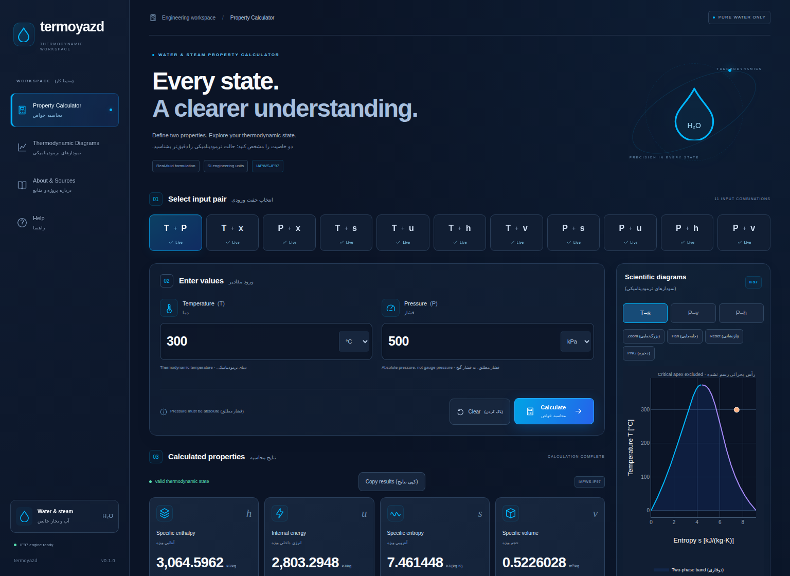

# termoyazd

**Pure water & steam thermodynamics · IAPWS-IF97 · React + Python**

**نسخه فعلی پروژه: termoyazd — ماشین‌حساب ترمودینامیکی آب و بخار**

[**شروع و مستندات کامل فارسی**](termoyazd/README_FA.md) · [**English documentation**](termoyazd/README.md) · [راهنمای ارائه به استاد](termoyazd/docs/PRESENTATION_FA.md)

نام تاریخی این مخزن **SteamLab** است. برنامه فعلی با نام دقیق **termoyazd** در پوشه [termoyazd](termoyazd/) قرار دارد. فایل‌های قدیمی ریشه برای حفظ سابقه باقی مانده‌اند.

The current application supports eleven engineering input pairs, real IF97 calculations, constrained inverse solving, a responsive dark dashboard, engineering-unit conversion, phase/region/quality reporting and calculated T–s/P–v/P–h diagrams. It can run with FastAPI or the same Python engine in a browser Web Worker. No fabricated scientific result is substituted for a failure.

## Quick start on macOS

```bash
git clone https://github.com/MaMali-c/SteamLab.git
cd SteamLab/termoyazd
bash start.command
```

Preferred local URL: http://localhost:5173; the launcher prints an alternative if busy. Local development requires Python/Node. A hosted browser-engine build needs no Python/Node installation for visitors. Source availability is not a claim of a deployed website.

## Explore the project

| Document | Contents |
|---|---|
| [راهنمای فارسی](termoyazd/README_FA.md) | هدف، امکانات، ساختار و اجرای پروژه |
| [User guide / راهنمای کاربر](termoyazd/docs/USER_GUIDE_FA.md) | Input pairs, units, results, charts and errors |
| [Architecture](termoyazd/docs/ARCHITECTURE.md) | Frontend, HTTP API and browser-Python paths |
| [Scientific model](termoyazd/docs/SCIENTIFIC_MODEL.md) | IF97 domain, algorithms, tolerances and ambiguity |
| [API reference](termoyazd/docs/API.md) | Request/response schema and error semantics |
| [Validation](termoyazd/docs/VALIDATION.md) | Traceable PDF dataset, comparisons and limitations |
| [Test execution](termoyazd/docs/TEST_RESULTS.md) | Actual checks, counts and unverified items |
| [Deployment](termoyazd/docs/DEPLOYMENT.md) | Vercel/Render or browser-engine static hosting |
| [Development](termoyazd/docs/DEVELOPMENT.md) | Reproducible builds, tests and troubleshooting |
| [Presentation](termoyazd/docs/PRESENTATION_FA.md) | Persian professor-facing explanation and demo |
| [Project status](termoyazd/docs/PROJECT_STATUS.md) | Implemented features and remaining work |

## Scientific transparency

The eleven modes do not imply every arbitrary input has a unique physical answer. Inverse global uniqueness is not mathematically certified and is flagged. In the recorded source-table comparison, 8/52 property differences fit printed output rounding; 44/52 exceed it and remain documented for investigation. Excel import/export, batch calculations and PDF reporting are not implemented. See the scientific and validation documentation before relying on results.

The active termoyazd verification workflow is at repository-root `.github/workflows/termoyazd-verify.yml`. Historical SteamLab files and tests are kept separately. No repository-wide license is newly selected by this update; see [notices](termoyazd/NOTICE.md).

## Dashboard / تصویر واقعی برنامه



Captured from the actual application after a successful T=300 °C, P=500 kPa IF97 calculation. [Mobile layout](termoyazd/docs/images/dashboard-mobile.png). These are application captures, not design mockups.

## Windows / نصب روی ویندوز

[راهنمای مرحله‌به‌مرحله نصب و اجرای ویندوز](termoyazd/docs/WINDOWS_FA.md) شامل Python و Node.js، دستورهای PowerShell، اجرای API و رابط، آزمون محاسبه و رفع خطاهای پورت و npm است. اجرای واقعی روی ویندوز در محیط فعلی تأیید نشده است.
