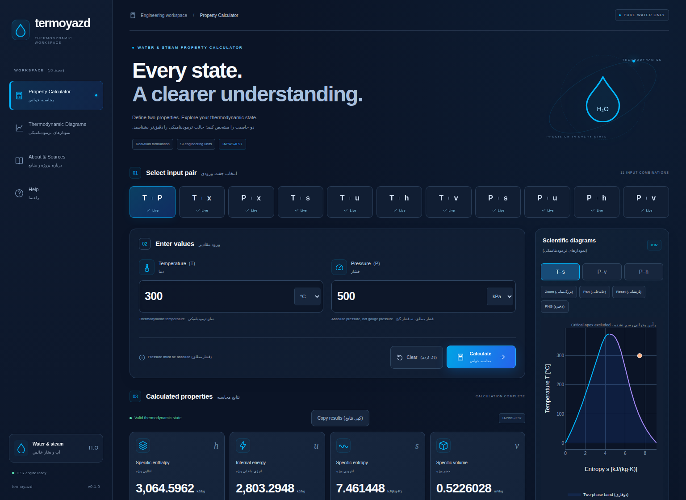

# termoyazd

**Water & steam thermodynamics, from an engineering input pair to an inspectable IF97 result.**

[راهنمای کامل فارسی](README_FA.md) · [Scientific model](docs/SCIENTIFIC_MODEL.md) · [Architecture](docs/ARCHITECTURE.md) · [API](docs/API.md) · [Validation evidence](docs/VALIDATION.md) · [Deployment](docs/DEPLOYMENT.md)

termoyazd is a university engineering project for **pure water and steam only**. It combines a dark, responsive React dashboard with the Python `iapws` implementation of IAPWS-IF97. The same calculation modules run behind FastAPI or inside a browser Web Worker using Pyodide. Successful outputs come from the equation library and verified numerical solutions; the interface does not substitute demonstration numbers for calculations.

The repository retains its historical name **SteamLab**. The current application and its documentation live in **`termoyazd/`**; older root-level files are preserved for history.

## Capabilities

- Exactly eleven input pairs, with property-specific engineering units and conversion.
- Four remaining main property cards, separate normalized inputs, full state, phase, IF97 region, physically defined quality and applicable saturation information.
- Native IF97 calls, equilibrium mixture relations and constrained SciPy inverse searches with recomputed residuals.
- Explicit invalid-input, saturation ambiguity, multiple-root and incomplete-search errors.
- T–s, P–v and P–h diagrams from calculated saturation data, with hover, zoom, pan, reset and PNG export controls.
- English engineering terminology with Persian supporting labels, input-change invalidation, loading/error states, reset and JSON result copying.
- macOS launcher with dependency setup, available-port selection, readiness checks and browser opening.
- Production configuration, request limits, automated tests, source-table dataset and reproducible comparison reports.

| Input pair | Meaning | Main result cards |
|---|---|---|
| T + P | Temperature + pressure | h, u, s, v |
| T + x | Temperature + vapor mass quality | h, u, s, v; saturation P separately |
| P + x | Pressure + vapor mass quality | h, u, s, v; saturation T separately |
| T + s | Temperature + entropy | P, h, u, v |
| T + u | Temperature + internal energy | P, h, s, v |
| T + h | Temperature + enthalpy | P, u, s, v |
| T + v | Temperature + specific volume | P, h, u, s |
| P + s | Pressure + entropy | T, h, u, v |
| P + u | Pressure + internal energy | T, h, s, v |
| P + h | Pressure + enthalpy | T, u, s, v |
| P + v | Pressure + specific volume | T, h, u, s |

**Scientific status:** inverse search is finite and does not mathematically certify global uniqueness. Those responses explicitly carry `uniqueness_certified=false`; a state marker is withheld on diagrams. Source-table validation also has unresolved discrepancies beyond printed rounding. See [limitations and evidence](docs/VALIDATION.md). Excel, batch calculations and PDF reports are **not implemented**.

## Run on macOS

Install Python and Node.js for local development. Python 3.14.10 and Node 22.14.0 are the versions exercised in this environment; the launcher accepts Python 3.11+ and the package declares Node 22–24.

```bash
git clone https://github.com/MaMali-c/SteamLab.git
cd SteamLab/termoyazd
bash start.command
```

The launcher creates its environment, installs dependencies, starts FastAPI and Vite, verifies the API proxy and opens the browser. Preferred address: **http://localhost:5173**. When occupied, it prints another available port. Keep Terminal open; Ctrl+C stops both services. The printed URL and `.runtime/session.json` describe the actual session.

For frontend-only browser-Python development, after `npm --prefix frontend ci`, run `npm run dev` from this directory. This is a separate workflow from the two-service launcher.

## Build and verify

Frontend checks, including the script named `test:unit`, require a running real API because the plotting test loads actual saturation data. Start the launcher or the API before invoking them.

Run these commands **inside `SteamLab/termoyazd`**:

```bash
python3 -m venv .venv
source .venv/bin/activate
python -m pip install -r backend/requirements-ci.txt
npm --prefix frontend ci
(cd backend && python -m pytest -q)
TERMOYAZD_TEST_API=http://127.0.0.1:8000 npm --prefix frontend run test:unit
npm run build
node scripts/verify-browser-engine.mjs
python validation/run_validation.py
```

The build verifies/downloads pinned browser-runtime assets and copies the actual Python modules. The first build needs network access; binaries are intentionally not committed. `dist/` is the packaged static site; `frontend/dist/` is Vite's output. See [development](docs/DEVELOPMENT.md) for API integration tests and environment options.

## Real example

With a local API running:

```bash
curl -s http://127.0.0.1:8000/api/calculate \
  -H 'Content-Type: application/json' \
  -d '{"input_pair":"T_P","values":{"T":300,"P":500}}'
```

The checked-in [actual response](examples/T_P.response.json), generated through FastAPI's TestClient, gives approximately **h = 3064.5962 kJ/kg**, **u = 2803.2948 kJ/kg**, **s = 7.461448 kJ/(kg·K)** and **v = 0.5226028 m³/kg**. These are IF97 calculations at 300 °C and 500 kPa, not values taken from the dashboard design reference.

## Project map

| Path | Responsibility |
|---|---|
| `frontend/src/` | React interface, unit conversion, response validation, transport and Plotly UI |
| `backend/app/engine.py` | Eleven-pair solver, candidates, inverse search and residual verification |
| `backend/app/thermo.py` | IF97 limits, T/P boundary validation and physical serialization |
| `backend/app/plotting.py` | Cached calculated saturation data |
| `backend/app/main.py` | FastAPI routes and application setup |
| `backend/app/settings.py` | Runtime environment, hosts, CORS and limits |
| `backend/tests/` | Engine, API, reference and production guard tests |
| `validation/` | Transcribed reference points, provenance, CSV errors and regeneration script |
| `scripts/` | Launcher orchestration, runtime verification, site packaging and smoke checks |
| `docs/` | Architecture, scientific model, API, deployment, development and Persian guides |

## Evidence and documentation

The previously completed CI run [44477559246](https://github.com/MaMali-c/SteamLab/actions/runs/44477559246) exercised backend tests, real browser-Python calculations, production API checks, React integration and both production build modes. New commits should be judged by their own Actions results. Test passing establishes the covered behavior; it is not industrial or experimental certification.

Read [project status](docs/PROJECT_STATUS.md), [Persian user guide](docs/USER_GUIDE_FA.md), [professor presentation guide](docs/PRESENTATION_FA.md), [contributing](CONTRIBUTING.md), [security configuration](SECURITY.md) and [dependency/source notices](NOTICE.md).

No live deployment URL is asserted here. Uploading source to GitHub does not itself start the application. Follow the deployment guide to enable hosting.

## Dashboard / تصویر واقعی برنامه



Captured from the actual application after a successful T=300 °C, P=500 kPa IF97 calculation. [Mobile layout](docs/images/dashboard-mobile.png). These are application captures, not design mockups.

## Windows / نصب روی ویندوز

[راهنمای مرحله‌به‌مرحله نصب و اجرای ویندوز](docs/WINDOWS_FA.md) شامل Python و Node.js، دستورهای PowerShell، اجرای API و رابط، آزمون محاسبه و رفع خطاهای پورت و npm است. اجرای واقعی روی ویندوز در محیط فعلی تأیید نشده است.
