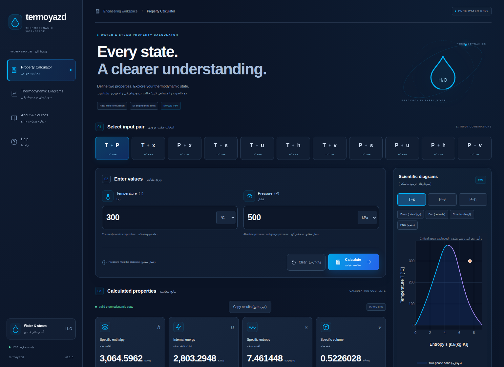

# termoyazd — راهنمای جامع فارسی

**ماشین‌حساب مهندسی خواص ترمودینامیکی آب خالص و بخار، با رابط تحت مرورگر و موتور واقعی IAPWS-IF97.**

[English README](README.md) · [راهنمای استفاده](docs/USER_GUIDE_FA.md) · [متن ارائه به استاد](docs/PRESENTATION_FA.md) · [مستند علمی](docs/SCIENTIFIC_MODEL.md) · [اعتبارسنجی](docs/VALIDATION.md)

## هدف پروژه

در مسائل ترمودینامیک معمولاً دو خاصیت مستقل معلوم است و باید بقیه خواص حالت را پیدا کرد. termoyazd این فرایند را برای آب و بخار انجام می‌دهد. نرم‌افزار به جدول نمایشی یا فرض گاز ایده‌آل متکی نیست؛ از کتابخانه Python به نام `iapws` و فرمول‌بندی صنعتی IF97 استفاده می‌کند. جدول مرجع برای مقایسه و ارزیابی اختلاف‌ها نگهداری شده است.

نام برنامه دقیقاً **termoyazd** است. نام تاریخی مخزن GitHub همچنان SteamLab است و نسخه فعلی در پوشه `termoyazd/` قرار دارد. فایل‌های قدیمی حذف نشده‌اند.

## ورودی‌ها و خروجی‌ها

یازده حالت ورودی: **T+P، T+x، P+x، T+s، T+u، T+h، T+v، P+s، P+u، P+h، P+v**.

| نماد | معنی | واحد اصلی |
|---|---|---|
| T | Temperature؛ دما | °C |
| P | Pressure؛ فشار مطلق | kPa |
| h | Specific enthalpy؛ آنتالپی ویژه | kJ/kg |
| u | Specific internal energy؛ انرژی داخلی ویژه | kJ/kg |
| s | Specific entropy؛ آنتروپی ویژه | kJ/(kg·K) |
| v | Specific volume؛ حجم ویژه | m³/kg |
| x | Vapor quality؛ کسر جرمی بخار | بین صفر و یک |

چهار کارت خروجی از بین خواص اصلی نمایش داده می‌شود و مقادیر ورودی جدا هستند. در حالت T+x، فشار اشباع و در حالت P+x، دمای اشباع نیز جداگانه گزارش می‌شود. فاز، شماره ناحیه IF97، کیفیت بخار در صورت تعریف فیزیکی، روش حل، باقیمانده‌های عددی و هشدارها هم در پاسخ موجود است.

## تجربه کاربری

داشبورد تیره با رنگ آبی مهندسی، ستون ناوبری، انتخاب زوج ورودی، دو فیلد عددی پویا، انتخاب واحد، دکمه محاسبه و پاک‌کردن، کارت نتایج و جزئیات علمی پیاده‌سازی شده است. اصطلاح‌های مهندسی انگلیسی با برچسب‌های کمکی فارسی همراه‌اند. تغییر ورودی یا واحد، نتیجه قبلی را پاک می‌کند تا خروجی قدیمی به ورودی جدید نسبت داده نشود. کپی نتیجه به شکل JSON نیز وجود دارد.

سه نمودار تعاملی T–s، P–v و P–h از داده‌های محاسبه‌شده واقعی اشباع تولید می‌شوند. نشانگر یک حالت فقط وقتی ظاهر می‌شود که پاسخ مجاز و یکتایی آن در قرارداد نرم‌افزار تأیید شده باشد. برای حل‌های معکوس، اثبات سراسری یکتایی وجود ندارد و نشانگر نمایش داده نمی‌شود.

## نحوه کار فنی

۱. رابط React زوج ورودی و اعداد را می‌گیرد و واحدها را به واحد اصلی تبدیل می‌کند.
۲. در حالت سروری، درخواست JSON به FastAPI ارسال می‌شود. در حالت انتشار ایستا، همان فایل‌های محاسباتی Python داخل Web Worker و Pyodide در مرورگر اجرا می‌شوند.
۳. موتور علمی، حدود مدل و ورودی‌ها را کنترل می‌کند؛ از حل مستقیم، رابطه مخلوط اشباع یا جست‌وجوی ریشه استفاده می‌کند.
۴. خواص ورودی دوباره محاسبه و با تلرانس مقایسه می‌شوند. چند جواب تأییدشده، خطای ابهام می‌دهد.
۵. رابط فقط پاسخ معتبر را نمایش می‌دهد. شکست محاسبه به شکل خطای روشن گزارش می‌شود.

## اجرای دقیق روی مک

برای توسعه محلی Python و Node.js لازم است؛ کاربر سایت منتشرشده به نصب آن‌ها نیاز ندارد.

```bash
git clone https://github.com/MaMali-c/SteamLab.git
cd SteamLab/termoyazd
bash start.command
```

اسکریپت وابستگی‌ها را نصب می‌کند، دو سرویس را بالا می‌آورد، سلامت و پروکسی را بررسی می‌کند و مرورگر را باز می‌کند. آدرس ترجیحی `http://localhost:5173` است؛ اگر پورت اشغال باشد آدرس جایگزین در ترمینال چاپ می‌شود. ترمینال باید باز بماند. برای توقف هر دو سرویس Ctrl+C بزنید. اگر Git روی مک نصب نیست، فایل ZIP مخزن را از دکمه Code دریافت و پس از بازکردن، در پوشه `termoyazd` دستور `bash start.command` را اجرا کنید.

## وضعیت علمی و مرز ادعاها

- هر یازده حلگر پیاده‌سازی و در آزمون‌ها استفاده شده‌اند؛ این به معنی معتبر بودن هر زوج دلخواه نیست.
- روی خط اشباع، T و P دو ورودی مستقل نیستند؛ بدون کیفیت یا خاصیت مستقل دیگر، جواب یکتا نداریم.
- کیفیت بخار در تک‌فاز `null` است؛ مقدار صفر یا یک ساختگی گزارش نمی‌شود.
- جست‌وجوی عددی محدود، اثبات ریاضی یافتن همه ریشه‌ها نیست؛ پاسخ‌های معکوس هشدار یکتایی دارند.
- از PDF ده نقطه مستقیم و سه مخلوط مشتق‌شده ثبت شده است؛ ۵۲ مقایسه خاصیت داریم. ۸ مورد در بازه گردکردن چاپی و ۴۴ مورد بیرون آن هستند. منشأ فرمول‌بندی جدول قطعی نشده و همه اختلاف‌ها را نمی‌توان گردکردن نامید.
- نقطه بحرانی دقیق و بخش نهایی منحنی اشباع در رسم نمودار پشتیبانی نمی‌شوند؛ محدوده‌ها در مستند علمی مشخص‌اند.
- پروژه فعلی برای آموزش و توسعه مهندسی است؛ اعتبارسنجی صنعتی یا تجربی جامع ادعا نمی‌شود.

## امکانات فعلی و کارهای بعدی

ماشین‌حساب، تبدیل واحد، نمودارها، کپی JSON، API، اجرای مرورگری Python، راه‌انداز مک و آزمون خودکار موجودند. **ورود/خروج Excel، پردازش دسته‌ای، ذخیره تاریخچه و گزارش PDF هنوز پیاده‌سازی نشده‌اند.** خروجی CSV موجود در پوشه validation گزارش اعتبارسنجی توسعه‌دهنده است و قابلیت خروجی اکسل داشبورد محسوب نمی‌شود.

برای انتشار، مسیر ساده‌تر میزبانی نسخه ایستا با موتور مرورگری است. مسیر React روی Vercel و FastAPI روی Render هم آماده پیکربندی است. [راهنمای انتشار](docs/DEPLOYMENT.md) تفاوت‌ها و تنظیم پوشه `termoyazd` را توضیح می‌دهد. وجود مخزن به معنی انتشار سایت نیست؛ در این مستند لینک زنده تأییدنشده ارائه نشده است.

## Dashboard / تصویر واقعی برنامه



Captured from the actual application after a successful T=300 °C, P=500 kPa IF97 calculation. [Mobile layout](docs/images/dashboard-mobile.png). These are application captures, not design mockups.

## Windows / نصب روی ویندوز

[راهنمای مرحله‌به‌مرحله نصب و اجرای ویندوز](docs/WINDOWS_FA.md) شامل Python و Node.js، دستورهای PowerShell، اجرای API و رابط، آزمون محاسبه و رفع خطاهای پورت و npm است. اجرای واقعی روی ویندوز در محیط فعلی تأیید نشده است.
