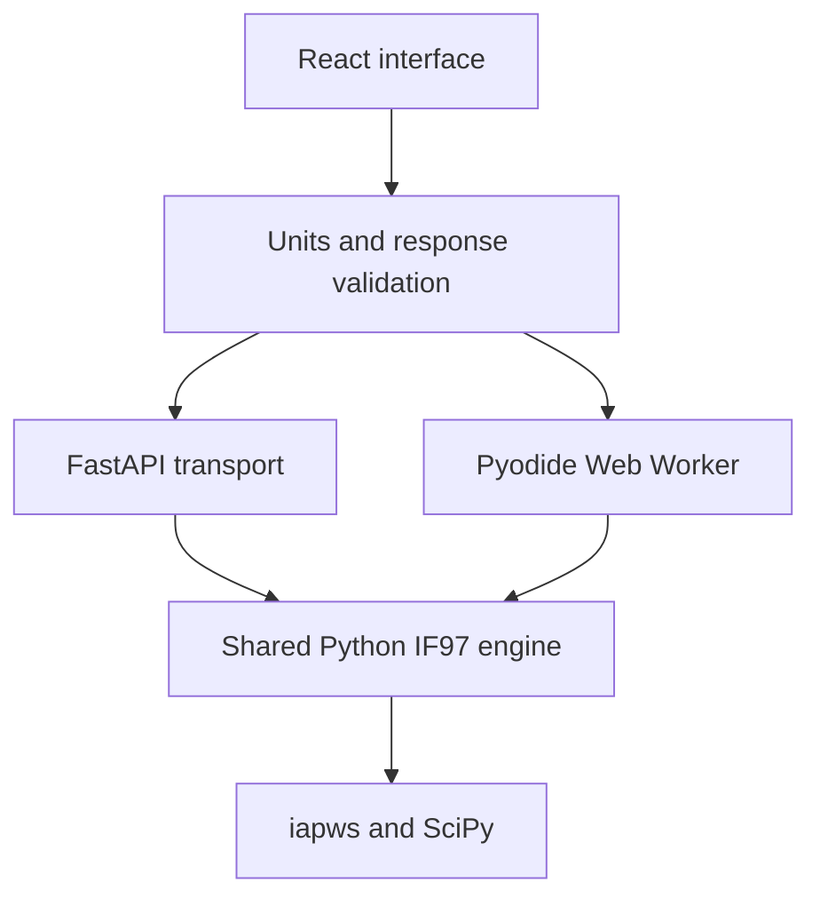

# Architecture

## Boundaries and ownership

The presentation layer selects inputs and units, validates transport responses and renders results. The scientific layer owns model validity, equilibrium behavior, roots and residual acceptance. Routes own HTTP behavior. Plotting owns calculated saturation coordinates independently of React.

Both transports use the same committed `engine.py`, `thermo.py` and `plotting.py`; the build copies these files to the worker's Python directory. Python/NumPy/SciPy versions differ between native and browser runtimes, so both need their own execution tests. Sharing source does not imply bit-for-bit equality across platforms.

## Request lifecycle

1. A pair determines exactly two visible fields. Unit conversion produces canonical engineering values.
2. Any edit invalidates the previous result. Submission enters loading state and selects the configured transport.
3. Pydantic validates native HTTP JSON; the scientific engine validates properties and ranges in either runtime.
4. The engine considers native, mixture and inverse candidates as appropriate, then recomputes input properties.
5. Rejected/ambiguous/incomplete states become errors. Accepted states include residual diagnostics and warnings.
6. The interface validates the response before committing result state. Four cards, selected inputs, region/phase and details share this single response.
7. Plotly receives saturation traces separately. State-marker eligibility is evaluated from convergence and uniqueness metadata.

## Module map

- `frontend/src/model.ts`: input-pair metadata, units, normalization and response rules.
- `frontend/src/plotting/`: diagram specification, axes, trace organization and state-marker rules.
- `frontend/src/`: React layout, HTTP/worker interaction and error/loading behavior; inspect the source tree for component-level organization.
- `backend/app/engine.py`: pair dispatch, inverse intervals, candidate collection, ambiguity and residuals.
- `backend/app/thermo.py`: constants, IF97 T/P limits, phase and boundary helpers.
- `backend/app/plotting.py`: bounded saturation sampling, finite-value validation and cached reuse.
- `backend/app/schemas.py`: explicit request, state, convergence and response models.
- `backend/app/main.py`, `settings.py`: routes, host/CORS validation and production guards.
- `scripts/prepare-frontend.mjs`: pinned runtime asset bootstrap and exact source copying.
- `scripts/browser-runtime-manifest.json`: runtime artifacts and expected checksums.
- `scripts/dev.py`: dependencies, ports, subprocess cleanup, health/proxy readiness and browser opening.

## Data, state and persistence

There is no application database, account system or retained calculation history. The user can copy a successful result as JSON. Validation CSV files are committed evidence, not user-session storage. The worker performs computations locally; a remote API deployment sends the submitted values to the selected server. Neither path requires external AI inference.

## Performance

Saturation data contains 161 points and is cached per Python process with a lock. Plotly loads separately from the main interface bundle. Browser runtime assets are self-hosted after the build, with roughly 36 MB of initial runtime downloads; warm loading depends on browser caching. Native API computations are bounded by a two-calculation semaphore by default. Browser-worker pending requests are bounded to eight. These mechanisms are admission limits, not a distributed job queue or hard solver deadline.

## Repository integration

The active repository workflow is `.github/workflows/termoyazd-verify.yml` at the repository root and runs commands inside `termoyazd`. Workflows stored inside `termoyazd/.github/workflows` are templates only: GitHub does not activate nested workflow directories. Legacy SteamLab checks remain separate.
